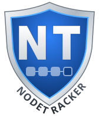
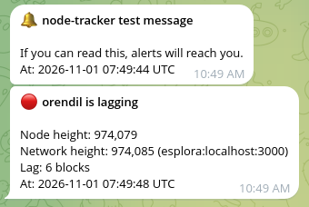

<p align="center">
  <picture>
    <source media="(prefers-color-scheme: dark)" srcset="assets/logo-dark.svg">
    
  </picture>
</p>

# node-tracker

**Get a Telegram message when your Bitcoin node falls behind the chain tip, and another when it catches up.**

A node that has lost its peers, is eclipsed, or hangs after a crash often
*looks* healthy: the process runs, the RPC port answers, and the node thinks
it is in sync because it hears of no new blocks. node-tracker compares your
node with independent views of the chain (mempool.space, blockstream.info or
your own nodes) and tells you when the gap crosses a threshold, in either
direction.

```text
$ node-tracker check
TARGET   STATE    NODE    TIP     LAG  TIP FROM               ERROR
orendil  LAGGING  974079  974085  6    esplora:mempool.space
```

…and on your phone:

> **🔴 orendil is lagging**
>
> Node height: 974,079
> Network height: 974,085 (esplora:mempool.space)
> Lag: 6 blocks
> Was: OK
> At: 2026-11-01 08:30:00 UTC


The demo runs against local fakes of bitcoind, Esplora and Telegram; see
[`docs/demo/`](docs/demo/). Pointed at the real Telegram, the same run
delivers this:



## Features

- **Catches the silent failures.** Your node's height is checked against
  independent references *and* against its own header chain, so it catches
  an isolated node as well as one that is stuck validating.
- **Alerts on change, not on every check.** One message when the node falls
  behind and one when it is back. Changes are debounced, and an optional
  recovery threshold stops the alerts from flapping.
- **Never goes blind quietly.** If the node is unreachable, or every
  reference fails, you get an alert for that too.
- **Alerts are never lost.** Alerts wait in a queue in the state file until
  they are delivered. A Telegram outage or a restart delays an alert but
  never drops it.
- **Run it your way.** As a daemon, from cron, as a systemd timer, as a user
  service, or by hand. All of them behave the same, and a lock stops two
  copies from clashing.
- **Hourly status reports** (optional) so you know the alerting itself still
  works.
- **Secure by default.** Secrets come only from files or environment
  variables, never from the config file. Tokens are scrubbed from errors and
  logs. Plain HTTP is allowed only to localhost. Tor/SOCKS5 proxies are
  supported, and only the read-only `getblockchaininfo` RPC is used.
- **One small static binary.** The Go standard library plus a YAML parser;
  no runtime and no database.

## Quick start

1. **Install.** Download the archive for your system (Linux amd64, arm64,
   armv7 for Raspberry Pi; macOS amd64, arm64) from the
   [releases page](https://github.com/al-maisan/node-tracker/releases),
   together with `SHA256SUMS` and `SHA256SUMS.asc`. Verify and unpack it
   (example for `v1.0.0` on Linux amd64):

   ```sh
   curl -s https://github.com/al-maisan.gpg | gpg --import && gpg --status-fd 1 --verify SHA256SUMS.asc SHA256SUMS 2>/dev/null | grep -q '^\[GNUPG:\] VALIDSIG .* 753B6ECF2B458FF3D19D568C1E0A288397AE739E$' && sha256sum --ignore-missing -c SHA256SUMS && tar -xzf node-tracker_1.0.0_linux_amd64.tar.gz
   ```

   The `grep` only passes for a good signature from the release key
   `753B 6ECF 2B45 8FF3 D19D 568C 1E0A 2883 97AE 739E`. On macOS use
   `shasum -a 256 --ignore-missing -c SHA256SUMS`. The archive holds the
   binary, this README, the docs, the systemd units and an example config.

   Or, with Homebrew (macOS, Linux amd64/arm64):

   ```sh
   brew install al-maisan/tap/node-tracker
   ```

   The docs are then in `$(brew --prefix)/share/doc/node-tracker`, the
   systemd units and example config in `$(brew --prefix)/share/node-tracker`.

   Or, with Go 1.26+:

   ```sh
   go install github.com/al-maisan/node-tracker/cmd/node-tracker@latest
   ```

   This puts `node-tracker` in `~/go/bin`. Or build from a clone:
   `make build` puts it in `bin/node-tracker`.

2. **Create a Telegram bot** and find your chat id. This takes about two
   minutes; see [docs/telegram.md](docs/telegram.md). Save the token:

   ```sh
   mkdir -p ~/.config/node-tracker && install -m 600 /dev/null ~/.config/node-tracker/telegram-token && $EDITOR ~/.config/node-tracker/telegram-token
   ```

3. **Configure.** Copy [examples/config.yaml](examples/config.yaml) to
   `~/.config/node-tracker/config.yaml`, then set your node's URL,
   `cookie_file` and `chat_id`.

4. **Check** that everything is reachable:

   ```sh
   node-tracker check          # samples every target, prints a table, sends nothing
   node-tracker test-notify    # sends a test message to Telegram
   ```

5. **Run it**, in one of these ways:

   ```sh
   node-tracker run            # in the foreground; or as a service, see below
   ```

## Ways to run

| How | Command | Good for |
|---|---|---|
| systemd service (system or `--user`) | `node-tracker run` | always-on servers |
| systemd timer | `node-tracker once` | intervals down to seconds, no resident process |
| cron | `node-tracker once` | intervals of one minute or more |
| by hand | `check`, `once`, `report` | setup, debugging, ad-hoc checks |

Ready-to-use units for both modes are in
[deploy/systemd/system](deploy/systemd/system) and
[deploy/systemd/user](deploy/systemd/user); a crontab example is in
[deploy/cron](deploy/cron). [docs/operations.md](docs/operations.md) walks
through each setup.

## Commands

| Command | What it does |
|---|---|
| `run` | daemon: one tick every `interval` |
| `once` | one tick, then exit |
| `check` | dry run: print a status table; touches no state, sends no alerts |
| `report` | send a status report of all targets to every notifier |
| `test-notify [name]` | send a test message through one notifier or all |
| `version` | version, git commit, build time, Go version |

Common flags: `-config`, `-state` (`run`/`once` only), `-log-format text|json`,
`-log-level debug|info|warn|error`.

Exit codes: `0` ok · `1` runtime failure or alerts not yet delivered · `2` bad config or usage ·
`3` another instance holds the lock · `4` a target is not in sync
(`once`, `check`, `report`).

## How it works

```text
tick:  lock state ─▶ sample node + references in parallel ─▶ classify ─▶ debounce
          │                                                                 │
          └──── save state ◀── deliver outbox (retry, backoff) ◀── queue alert on change
```

- **Tip** = the highest of all reference heights and the node's own header
  height. Taking the highest means a stale or broken reference can never hide
  a lagging node.
- **Lag** = tip − the node's validated height.
- **States:** `OK`, `LAGGING`, `NODE_DOWN`, `NO_REFERENCE`. An alert is sent
  only on a debounced change of state. The first `OK` after setup is silent.

[docs/design.md](docs/design.md) explains every decision.

## Why not …?

| Alternative | Why node-tracker |
|---|---|
| **Prometheus + Alertmanager + a bitcoind exporter** | Great if you already run that stack, but it is a lot of moving parts for one node, and the exporter only knows what the node knows. node-tracker is one binary with independent references built in. |
| **Uptime Kuma / port checks** | They tell you the RPC port answers, not that the node is in sync. |
| **A homegrown cron script** | Usually alerts on every run while the node lags, loses alerts when Telegram is down, and has the bot token in the script. node-tracker debounces, queues alerts until delivered, and keeps secrets out of the config. |

## Documentation

- [Configuration reference](docs/configuration.md)
- [Telegram setup](docs/telegram.md)
- [Operations: deployment, logs, state, Tor, troubleshooting](docs/operations.md)
- [Design](docs/design.md)

## Roadmap

Ethereum nodes (`eth_blockNumber` / `eth_syncing`) and Slack and email
notifiers. The design already has extension points for these: each new kind
is one source or notifier implementation.

## Contributing

Issues and pull requests are welcome; see [CONTRIBUTING.md](CONTRIBUTING.md).
Report security problems privately, see [SECURITY.md](SECURITY.md).

## License

[GPL-3.0-only](LICENSE): GNU General Public License, version 3 only.
